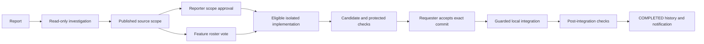

# DevDesk

A local C++ employee workbench that investigates controlled bug reports, obtains source permission, generates and checks a candidate, waits for requester acceptance, and verifies integration before completion. Features additionally require a fixed-roster two-thirds vote. Real Gemini candidates fixed mobile button overlap, backend status filtering and the missing Completed filter.

Current implementation supports those three registered capabilities, local Git integration, in-app notifications and foreground workers. GitHub PR/reporter/admin integration remains planned. This is a Windows development/demo workspace, not a hosted production service.

## Start on the configured machine

Keep Docker Desktop's Linux engine running. From `C:\AI_employee`, use separate terminals:

```powershell
powershell -NoProfile -ExecutionPolicy Bypass -File .\tools\Start-Workbench.ps1
powershell -NoProfile -ExecutionPolicy Bypass -File .\tools\Start-Workers.ps1
```

Workbench: http://127.0.0.1:8094. Accepted previews: frontend8081, backend8082, feature8083. Read synthetic account passwords locally from `var/config/demo-accounts.json`; never share that file or keys. Keep launcher terminals open and restart old workers after a new release. Main manual reports were preserved; completed model demonstrations use separate schemas. See [setup and demo instructions](docs/SETUP_AND_DEMO.md).

## Workflow



Bugs do not need feature voting. Features require both reporter scope permission and `ceil(2N/3)` yes votes:4 members need3,5 need4. Votes cannot change; no response is not approval. Missing information, expired/stale authority, failed/unknown checks and insufficient consensus stop progress truthfully. Model output alone cannot produce COMPLETED.

## Stack and source map

| Path | Responsibility |
| --- | --- |
| devdesk/src | C++20 routes, authentication, provider, investigation, repair, consensus, integration, recovery |
| devdesk/db and devdesk/static | PostgreSQL migrations and plain browser UI |
| devdesk/runner and tools | Protected Docker evaluator, fixed helpers, setup/build/launcher/package scripts |
| trusted_checks | Independent checks outside editable application scope |
| playground | Clean C++/SQLite Git repo; restored from bundle in a fresh package |
| var | Ignored local keys/data/worktrees/evidence/releases; excluded from source archive |
| docs | Setup, evidence, disclosures, demo and interview/phase guides |

Observed stack: GCC16.2.0, Node24.11.1, Git2.47.1, PostgreSQL17.11, Docker Linux, Chrome/Chromium, Playwright1.64.0, cpp-httplib0.60.1, nlohmann/json3.12.0. Licenses/lockfile are included. Gemini `gemini-3.5-flash-lite` is the user-selected live model alias. C++ validates typed actions; model-edited app code runs only inside the verified runner. [Architecture](ARCHITECTURE.md) and [disclosures/limits](docs/DISCLOSURES_AND_LIMITS.md) include Codex assistance and boundaries.

## Evidence and packaging

| Demonstrated case | Candidate/integrated checks | Commit |
| --- | --- | --- |
| Mobile overlap |20/20 PASS |4945512e8e8d07ca6901a1581bc1363d2cbc7254 |
| Backend filter |26/26 PASS |0ea464b86c4005c99c5e600bdd7da98bd0aa03f5 |
| Completed filter |22/22 PASS |b8509a4cb64bc19be911d0a5800d0e88aa29cc2c |

These are three eventual controlled completions, not a model reliability percentage. Retained failures, receipts and varying releases are recorded in [BUILD_STATUS](BUILD_STATUS.md) and the [verification matrix](docs/VERIFICATION_MATRIX.md).

```powershell
node .\trusted_checks\phase9.mjs
node .\tools\Package-DevDesk.mjs
node .\trusted_checks\phase9-package.mjs
```

Phase9 validates historical evidence and runs current regression/startup checks without inference. The source ZIP and checksum are identified by `var/packages/latest.json`. It contains source, licenses, a playground Git bundle, restore script and selected assertion-only reports; no local keys/accounts/databases/uploads/builds are included. Source repository: https://github.com/Jayadityas/DevDesk_AI_Employee. [Fresh-package setup](docs/SETUP_AND_DEMO.md) explains prerequisites and generic runner verification. Archive-only live drivers must not be blindly rerun against repaired fixtures or a fresh archive.

## Learning and submission material

- [Setup, troubleshooting and five-minute recording plan](docs/SETUP_AND_DEMO.md)
- [Critical scenario matrix](docs/VERIFICATION_MATRIX.md)
- [Models, components, assistance and limitations](docs/DISCLOSURES_AND_LIMITS.md)
- [Interview/debugging exercises](docs/INTERVIEW_AND_DEBUGGING.md), [Phase9 packaging guide](docs/PHASE9_PACKAGING_GUIDE.md)
- [Backend guide](docs/PHASE7_BACKEND_GUIDE.md), [feature guide](docs/PHASE8_FEATURE_GUIDE.md)
- [Learning log](LEARNING_LOG.md), [specification/future GitHub flow](SPEC.md)

Earlier README content is retained in [historical notes](docs/README_HISTORY.md); current setup above supersedes old native-fixture launch instructions. No video was recorded/uploaded. Review the interview exercises and explain one recorded repair, each permission boundary and a failure/recovery case at the final learning checkpoint.
