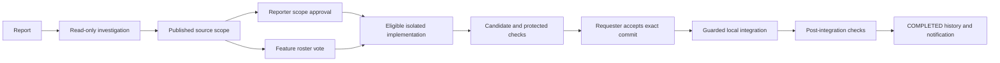

# DevDesk

An AI-assisted C++ employee workbench that investigates controlled bug reports, obtains source permission, generates and checks a candidate, and waits for requester acceptance before verified integration. Feature proposals additionally require a fixed-roster two-thirds vote. Real Gemini candidates repaired mobile button overlap, backend status filtering and the missing Completed filter.

**Demo video:** [Watch DevDesk on Loom](https://www.loom.com/share/398ea7183b0b483f863caeb1ef3ba4fb).

The prototype supports three registered capabilities, local Git integration, in-app notifications and foreground workers. Automated GitHub PR/reporter/admin integration is planned. This is a local Windows prototype with synthetic accounts and data.

## Setup and run

Follow [setup instructions](docs/SETUP_AND_DEMO.md) for prerequisites, source restoration, local configuration, build and Docker verification. On the configured workspace, keep Docker Desktop's Linux engine running and use separate PowerShell terminals:

```powershell
powershell -NoProfile -ExecutionPolicy Bypass -File .\tools\Start-Workbench.ps1
powershell -NoProfile -ExecutionPolicy Bypass -File .\tools\Start-Workers.ps1
```

Workbench: http://127.0.0.1:8094. Playground previews: frontend8081, backend8082 and feature8083. Synthetic credentials are generated locally in var/config/demo-accounts.json; they are not published. Keep launcher terminals open. The playground source/history is restored from distribution/playground.bundle.

## Workflow



Bugs do not need feature voting. Features require both reporter scope permission and ceil(2N/3) YES votes. Missing information, expired/stale authority, insufficient consensus and failed/unknown checks stop progress. Model output alone cannot produce COMPLETED.

## Architecture and stack

| Path | Responsibility |
| --- | --- |
| devdesk/src | C++20 authentication, routes, provider, investigation, repair, consensus, integration and recovery |
| devdesk/db and devdesk/static | PostgreSQL workflow migrations and plain HTML/CSS/JavaScript UI |
| devdesk/runner and tools | Protected Docker evaluator, fixed helpers and setup/build/launcher/package scripts |
| trusted_checks | Independent policy, workflow and browser/API checks |
| distribution | Playground Git bundle, fixture catalog, source manifest and selected assertion-only evidence |
| docs | Setup, verification, submission overview and disclosures |

Live model: Google's Gemini API with configured alias gemini-3.5-flash-lite. Other components include PostgreSQL/libpq, SQLite, cpp-httplib, nlohmann/json, Node.js, Playwright, Chrome/Chromium, Docker and Git. Codex assisted implementation, tests, troubleshooting and documentation. Model-edited application code runs only inside the protected runner. [Architecture](ARCHITECTURE.md) describes boundaries and design decisions; [disclosures](docs/DISCLOSURES_AND_LIMITS.md) lists components, assumptions and limitations.

## Verification

| Demonstrated case | Candidate and integrated assertions | Accepted commit |
| --- | --- | --- |
| Mobile overlap | 20/20 PASS | 4945512e8e8d07ca6901a1581bc1363d2cbc7254 |
| Backend filter | 26/26 PASS | 0ea464b86c4005c99c5e600bdd7da98bd0aa03f5 |
| Completed filter | 22/22 PASS | b8509a4cb64bc19be911d0a5800d0e88aa29cc2c |

These are eventual controlled completions, not a model reliability percentage. [Verification coverage](docs/VERIFICATION_MATRIX.md) describes tested failure cases and practical limits. Selected historical assertion reports are included under distribution/evidence; full local runtime databases and receipts are excluded.

Use the sequential generic runner checks in the setup guide after restoring fixtures. Other archival test drivers may require historical local evidence and configured infrastructure; they are not generic fresh-clone setup commands. Packaging on the configured development workspace uses tools/Package-DevDesk.mjs. Publication uses tools/Push-GitHubChanges.ps1 with a commit message; personal preparation files remain ignored and excluded from packaging.

## Submission

- [Setup and troubleshooting](docs/SETUP_AND_DEMO.md)
- [Architecture and design decisions](ARCHITECTURE.md)
- [Product scope and future work](SPEC.md)
- [Submission overview](docs/SUBMISSION_OVERVIEW.md)
- [Verification coverage](docs/VERIFICATION_MATRIX.md)
- [Models, AI assistance, assumptions and known limitations](docs/DISCLOSURES_AND_LIMITS.md)
- [Demo video](https://www.loom.com/share/398ea7183b0b483f863caeb1ef3ba4fb)
