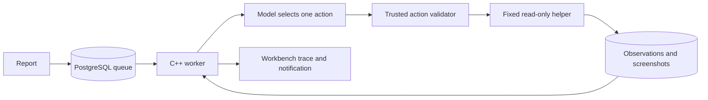

# Phase 3: read-only investigator

Implemented on 11 October 2026. Live Gemini investigation is now verified: the final pilot passed all eight checks. Earlier unsuccessful pilots remain recorded below. The successful scripted checks below exercise real source reads, HTTP observations, Chrome and database persistence, but supply scripted decisions rather than AI decisions. A real model-selected read-only investigation is demonstrated; no autonomous repair is claimed.

## Structure and responsibilities

| Path | Purpose |
| --- | --- |
| `devdesk/src/worker.hpp` | Shared action/provider/worker interface; `ModelReply` carries action, usage and provider response ID. |
| `devdesk/src/provider.cpp` | `action_schema`, `decision_schema`, `gemini_schema`, `validate_action`, `parse_model_reply`, `parse_gemini_reply`, `model_decide`, `verify_model_access`: strict one-action responses, independent policy validation, TLS API calls and nonbilling model-access probe. |
| `devdesk/src/worker.cpp` | `run_worker` owns claim, recovery, decision/observation persistence, budgets and conclusion. `helper` executes only the fixed observation helper; `Kernel` closes Windows handles through RAII. |
| `devdesk/src/main.cpp` | Dispatches server, seed, worker, explicitly gated test-worker, self-check and model-access modes. |
| `devdesk/db/002_investigation.sql` | Durable runs, decisions, observations, worker events, additional read-only states and incomplete-usage tracking. |
| `devdesk/prompts/investigation.md` | Versioned decision instructions and tool contracts. |
| `devdesk/prompts/project.md` | Trusted Team Tasks context; no fixture-to-patch answer table. |
| `tools/investigation-helper.mjs` | Fixed source listing/read/search, baseline identity, GET-only API and Chrome observations. |
| `tools/Configure-Model.ps1` | Creates ignored local model settings without overwriting an existing configuration. |
| `tools/Start-Investigator.ps1` | Checks configuration/access, starts one worker process per investigation and optionally polls. |
| `devdesk/build/releases/<digest>/` | Immutable executable, assets, prompts and helper snapshot. `latest.json` selects the current build. |
| `trusted_checks/phase3.mjs` | Offline decision tests against actual database, fixture APIs and Chrome. |
| `trusted_checks/phase3-live.mjs` | Separate live pilot in a fresh test schema, pending local credentials. |

Phase 2's `support.cpp` still owns database/authentication primitives. The worker uses the same `Database`, `Result` and `Transaction` RAII contracts: scope exit releases resources, and an uncommitted transaction rolls back. `provider.cpp` similarly closes WinHTTP handles, while `worker.cpp` closes process/job handles. RAII manages lifetime; it does not grant permissions or establish operating-system isolation.

## One investigation, step by step

1. An employee submits a report. Phase 2's transaction creates the request, queued investigation, ticket, event and acknowledgement.
2. The worker validates live configuration before claiming anything. A PostgreSQL advisory lock allows one project investigator. It reconciles abandoned running records without replaying an ambiguous model request.
3. It claims a QUEUED ticket in priority/time/ID order and records the run, model, prompt version, source commit and build identity.
4. It persists a STARTED decision before requesting the next action. The provider requests exactly one structured action; the trusted C++ validator independently checks it before execution.
5. The fixed helper performs the permitted read and returns structured facts. The worker stores an observation, assertion results and any screenshot. The next decision receives bounded accumulated context.
6. A conclusion requires project instructions, a successful source read and cited observations from this run. Reproduced requires a relevant observed FAIL; not reproduced requires observed PASS evidence without FAIL. Missing evidence, policy violations, errors or exhausted budgets produce NEEDS_INFORMATION.
7. The worker rechecks source/build identity, records the read-only conclusion and a persistent notification. The ticket can become INVESTIGATED_READ_ONLY, never COMPLETED here.

The worker is a C++ application; the cloud model selects actions. The workbench's persistent queue is its inbox. This phase connects that inbox to the worker adapter, but an actual AI investigation remains unverified until the live pilot passes.



## Tools and boundaries

Tools are `project_instructions`, `source_list`, `source_read`, `source_search`, `api_observe`, `browser_observe` and `finish`. There is no shell, source-write, SQL, build, approval or integration tool. Source paths are tracked files under `src/` or `static/`, with allowed extensions, byte/line bounds and no symlink traversal. Learning guides, fixture setup, evaluator code, dependencies and credentials are excluded from model source retrieval.

The report binds a controlled origin to its registered fixture. The model cannot choose another origin, checkout, command or output path. API/browser traffic permits selected GET routes only; redirects and external destinations are denied. Browser observation uses the submitted viewport. Task status changes and creation are unavailable. Identity checks compare clean Git HEAD, source-byte digest, frozen build metadata and server health before/after observations.

Assertions distinguish PASS, FAIL and UNKNOWN. A screenshot is supporting evidence; button geometry and live filter results provide observable facts. Missing Completed UI is not treated as evidence of an unrelated bug. Feature observations do not authorize implementation or manufacture votes. Read-only investigation does not promote provisional priority to P0/P1.

The helper runs in a Windows Job Object with timeout, process and memory limits and a restricted inherited environment. Chrome needs the native USERPROFILE path to start; its temporary browser profile is separate from personal browser data. These measures do **not** establish filesystem containment of arbitrary code. No model-edited code is executed. Demonstrated repair isolation remains a Phase 4 prerequisite.

## Budgets and recovery

Default configuration selects `gemini-3.5-flash-lite`, enables screenshot input, and limits an investigation to 12 actions, 12 model calls, 300 seconds, 200,000 tokens and a configured $0.50 estimated budget. Input/output rates are configurable estimates, not a provider-enforced billing cap. Conservative reservations precede calls; actual usage is persisted when received. An ambiguous failed response leaves `usage_complete=false`, and the UI warns that the estimate is incomplete. Calls are not automatically replayed.

Each helper has a 25-second bound, and provider requests have separate network timeouts. The overall elapsed budget is checked between operations, so it is not an exact wall-clock kill deadline. Repeat-action detection and context limits further bound the loop. Recovery testing used a synthetic abandoned database record; an actual crash during a billed model request has not been demonstrated.

Serial actions simplify evidence order, budgeting and recovery at the cost of latency. Immutable builds also avoid overwriting the executable/assets used by an existing Windows preview. The existing Phase 2 preview can keep serving its old version until the user restarts it.

## Commands and manual walkthrough

Run from `C:\AI_employee` in PowerShell:

```powershell
.\tools\Build-Workbench.ps1
.\tools\Start-Workbench.ps1 -Port 8098
```

Port 8098 lets you inspect the new release without stopping your existing 8094 preview. In another terminal, ensure the reported fixture is serving; reuse your existing frontend preview on 8081. If it is not running:

```powershell
.\tools\Start-Playground.ps1 -Scenario frontend -Port 8081
```

Log in using an account from ignored `var/config/demo-accounts.json`, submit a cosmetic report for `http://127.0.0.1:8081` with viewport 390x844 and describe the overlapping task buttons. An uploaded screenshot is optional supporting evidence. Observe the QUEUED ticket and acknowledgement before starting the worker.

Configure credentials locally; never paste them into chat:

```powershell
notepad .\var\config\model.json
node .\trusted_checks\phase3-live.mjs --probe-only
node .\trusted_checks\phase3-live.mjs
.\tools\Start-Investigator.ps1 -Once
```

The probe checks model access without an inference request. The live pilot processes one synthetic report in a separate test schema and may incur API cost. `Start-Investigator -Once` processes a queued report in the normal workbench; omit `-Once` to poll. Refresh ticket details to inspect actual actions, source/build identity, assertions, screenshots, usage and notification. A model may request more information; that is a recorded outcome, not an invented reproduction.

Offline verification commands:

```powershell
node .\trusted_checks\phase3.mjs
node .\trusted_checks\phase2.mjs
```

## Actual verification

Latest build: `070f5268e483b7889cfe1327737d8076fc1f500cb9745e54778c826991226a8a`.

- Phase 3: **59 PASS, 0 FAIL**, 80.488 seconds; `var/evidence/phase3-2026-10-11T13-16-13.258Z-41412/report.json`. Explicit scripted-test mode, **zero live model calls**.
- Phase 2 regression: **95 PASS, 0 FAIL**, 20.790 seconds; `var/evidence/phase2-2026-10-11T13-16-13.656Z-98936/report.json`.
- Checks include real backend filter failure, frontend Chrome overlap/screenshot, clean pass, context/claim gates, forbidden actions/paths/origins, foreign evidence IDs, repeated actions/budgets, advisory-lock capacity, recovery record, notification uniqueness, screenshot authorization and real workbench trace/mobile display. Registered fixture source and existing frontend task data were preserved.
- Live model access, structured/image request handling and model-selected frontend reproduction are verified in the final pilot below. Broad reliability, live backend/feature scenarios, interactive Ctrl+C, Linux portability and arbitrary-code isolation remain unverified.

Observed failures informed fixes: inherited environment omission prevented Node/Chrome startup; a synthetic USERPROFILE also failed Chrome, so native USERPROFILE is retained while job TEMP hosts the fresh profile. A blocking scripted test exposed stale HTTP connections in the test driver; it now closes those connections. Windows denied overwriting a running executable, motivating immutable releases. Earlier failed evidence remains available.

## Interview practice and exercise

1. **Why validate a strict model action twice?** Explain provider schema versus trusted runtime authority, path/origin checks and the absence of command/write tools.
2. **What happens if the worker crashes around a model call?** Explain STARTED persistence, ambiguous usage, advisory-lock recovery, no blind replay and NEEDS_INFORMATION.
3. **What proves a report was reproduced?** Trace submitted allegation to live assertions, cited observation ownership and stable source/build identity; distinguish read-only investigation from repair and acceptance.

Exercise: inspect one scripted backend run's decisions and observations. Find the source read, compare observed All/todo/done task IDs, identify the failing assertion and explain why the ticket is still not COMPLETED. Then try a protected source path through the isolated test harness and explain the denial without weakening the validator.

Phase 3 implementation and live verification are complete; pause at the learning checkpoint. Phase 4 will introduce authorized scoped changes only after repair isolation is demonstrated; it must not reuse these host observation limits as proof of arbitrary-code safety.


Gemini provider update: user selected gemini-3.5-flash-lite. Native Google generateContent requests use responseJsonSchema for one action, PNG/JPEG inline input and x-goog-api-key over fixed-host TLS. C++ policy checks remain authoritative. Gemini parser rejects incomplete/multiple candidates, unexpected model identity and inconsistent usage; non-input tokens conservatively include thinking. A GET models probe verifies generateContent support before inference. Configuration now selects provider gemini and rates $0.30 input/$2.50 output per million tokens (Google standard pricing); the $0.50 application estimate remains. Stable model aliases may evolve and are not immutable dated snapshots. OpenAI remains supported as an alternative. Live Gemini verification passed; the credential remains local and ignored. Official references: https://ai.google.dev/gemini-api/docs/models/gemini-3.5-flash-lite and https://ai.google.dev/gemini-api/docs/pricing .

Gemini adapter verification: build 5e6b94964c67ff5703fdea0ad20ef767f8590c62e88194887cbdf07dced032a9 compiled successfully. C++ policy/provider self-checks: 14 PASS (five new Gemini checks). Full Phase 3 scripted suite: 59 PASS, 0 FAIL, 74.596 seconds, var/evidence/phase3-2026-10-11T12-35-16.943Z-69420/report.json. Live pilot JavaScript syntax check passed. The live probe stopped before networking because the Gemini key is empty; zero live model calls. Phase 2's last separate regression remains 95 PASS on the preceding build; it was not rerun for the provider-only change. Configure the Gemini key locally in var/config/model.json to finish live verification. Existing previews and fixture data are preserved.

Live Gemini access was confirmed with the configured local credential using GET models. First pilot var/evidence/phase3-live-2026-10-11T12-37-25.266Z-39504/report.json attempted one inference request, but transport failed after about 33 seconds. It retained NEEDS_INFORMATION and usage_complete=false; zero measured tokens/cost do not prove zero billing. No source was edited. A bounded fresh pilot uses a 90-second response timeout and safe numeric Windows transport diagnostics. No automatic replay of the uncertain request occurs. Updated live driver saves the redacted trace even when an assertion fails. Model capability/reproduction remains pending the fresh pilot result.


Live prompt-v3 pilot var/evidence/phase3-live-2026-10-11T12-58-35.383Z-63644/report.json selected real Chrome observation and measured 1,360 pixels² button intersection at 390x844. Gemini then attempted a conclusion without a source read; trusted validation denied it. Received usage: 7,444 input/343 output tokens, estimated $0.003526. Thus live image/structured request, model-selected browser observation and screenshot persistence are demonstrated, but the complete investigation gate had not passed. Prompt v4 uses decision_schema to omit finish until successful project context, source read and live assertions exist. This narrows model choices without changing tool execution permissions or bypassing conclusion validation. Three new self-checks cover prerequisite absence, partial prerequisites and eligibility. No expected fixture result or known repair is inserted.

Prompt-v4 pilot var/evidence/phase3-live-2026-10-11T13-00-48.741Z-13156/report.json correctly denied browser_observe carrying a source path (three calls, 7,121 input/263 output tokens, estimated $0.003269). The flat schema's irrelevant-field defaults were unreliable with this model. Gemini now receives tool-specific anyOf variants inside one action envelope: unused string fields are constrained to empty, non-finish citations to zero items, and finish is unavailable before prerequisites. Budget reservations include the larger actual Gemini schema. Three new checks cover branch count and browser/finish argument restrictions. This is generic contract enforcement, not fixture diagnosis or a repair mapping; C++ validation remains authoritative. Earlier failed live evidence and unknown first-request billing remain retained.


## Final Phase 3 verification — 11 October 2026

Implementation and live verification are complete; pause at the learning checkpoint. Build 070f5268e483b7889cfe1327737d8076fc1f500cb9745e54778c826991226a8a, investigation-v4, Gemini gemini-3.5-flash-lite. Final live report var/evidence/phase3-live-2026-10-11T13-15-55.785Z-87240/report.json: 8 PASS/0 FAIL, 36.266 seconds. Six model decisions: project instructions -> source list -> static/styles.css read -> API observation -> Chrome observation -> evidence-cited reproduced conclusion. Browser measured 1,360 pixels² overlap at 390x844; screenshot was saved and visually inspected. Source/data identity stayed unchanged. Run FINISHED; ticket INVESTIGATED_READ_ONLY, never COMPLETED. No source edit/approval/repair/integration occurred.

Live usage: 25,165 input and 679 output tokens (conservative thinking-inclusive count), estimated $0.011152 for the successful run. Earlier pilot receipts total an additional $0.016399 estimated; the first timed-out request's billing is unknown, so the complete session total is not established. Stable model alias is not an immutable dated snapshot. Accepted screenshot requests demonstrate input transport, not a visual reasoning benchmark. Failures exposed schema/prompt weaknesses; typed tool variants and prerequisite schema gating fixed the demonstrated path without bypassing policy.

Final same-build checks: 20 C++ self-checks PASS; Phase 3 scripted report var/evidence/phase3-2026-10-11T13-16-13.258Z-41412/report.json: 59 PASS/0 FAIL, 80.488 seconds; Phase 2 regression var/evidence/phase2-2026-10-11T13-16-13.656Z-98936/report.json: 95 PASS/0 FAIL, 20.790 seconds. Test servers were cleaned by their launchers; existing user workbench PID 115708 and frontend PID 21624 remain running. Existing PostgreSQL was preserved. Native HTTPS required approved execution outside the tool sandbox. No credential was printed.

Full map, commands, trace, manual walkthrough, three interview questions and learning exercise are in docs/PHASE3_INVESTIGATOR_GUIDE.md. The final live schema/tool changes were retested; repeated tests are now unnecessary absent a new change. Unverified: broad model reliability, live backend/feature scenarios, actual crash during billed inference, interactive Ctrl+C, Linux portability and arbitrary-code isolation. Scripted recovery used an abandoned record. Phase 4 must demonstrate repair isolation before any model-edited code execution and add explicit source-change approval. Do not interpret this read-only success as permission to edit source; wait for the user's continuation after learning.


