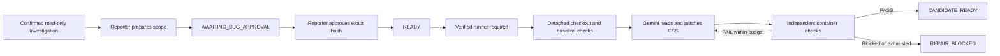

# Phase 4: approved, bounded frontend repair

Historical checkpoint: Phase 5 subsequently accepted this candidate and advanced shared frontend source to its commit. See [the Phase 5 guide](PHASE5_ACCEPTANCE_GUIDE.md) for current source status and preview limitations. The Phase 4 evidence below records the state before integration.

Phase 4 is implemented and demonstrated. Docker's restored Linux engine built the pinned runner; containment, timeout and failing-baseline checks passed. A real Gemini investigation and approved repair produced a verified frontend candidate in a separate checkout. The shared application has not been integrated, and the ticket is not completed. No model-edited application was built or executed on the host.

## What changed and why

Phase 3 could reproduce a report without modifying source. Phase 4 separates the authority to investigate from the authority to repair. Only the reporter can approve a specific proposal. The first repair scope is the frontend fixture on port 8081 and `static/styles.css`; backend and feature changes belong to later phases.

The normal flow is:



`CANDIDATE_READY` means a separate proposed commit passed checks. It does not mean the shared application changed or the ticket is completed. Final acceptance and integration are Phase 5.

## Folder and function map

| File | Responsibility |
| --- | --- |
| `devdesk/db/003_repair.sql` | Adds proposal, approval, repair-run and repair-step records and ticket states. |
| `devdesk/src/routes.cpp` | Prepares a scope, verifies reporter approval and returns repair details and authorized screenshots. |
| `devdesk/src/repair.hpp` | Declares repair contracts and the worker entry point. |
| `devdesk/src/repair.cpp` | `repair_schema` and `repair_gemini_schema` constrain actions; `repair_selftest` checks contracts; `run_repair` claims authorized work, tracks budgets, executes tools and records results. |
| `devdesk/src/provider.cpp` | Uses the repair schema for repair requests and retains the investigation schema for read-only requests. Native HTTPS keeps credentials out of helper jobs. |
| `devdesk/src/worker.cpp` | `repair_helper` launches the frozen helper inside a Windows Job Object. That limits the helper process; genuine application execution isolation comes from Docker. |
| `devdesk/src/main.cpp` | Dispatches `--repair`, `--test-repair`, `--patch-only` and `--repair-selftest`. |
| `devdesk/static/app.js` | Displays scope, approval, state, diff, usage, steps and candidate screenshots using text-safe DOM operations. |
| `devdesk/prompts/repair.md` | Explains the action contract, baseline-before-edit rule and disclosed fallback to Gemini. It grants no authority. |
| `tools/repair-helper.mjs` | Creates a detached worktree, checks identity, reads/replaces approved CSS, returns diffs, invokes the fixed container and commits a verified candidate. |
| `devdesk/runner/Dockerfile` | Defines the non-root runner image containing the trusted compiler, Chromium and evaluator. Image build remains pending. |
| `devdesk/runner/check.mjs` | Independent containment probes, fixed application build and geometry/API checks. It is outside the model's editable scope. |
| `tools/Build-RepairRunner.ps1` | Builds the image and records its immutable image ID. Building alone does not mark it verified. |
| `trusted_checks/phase4-isolation.mjs` | Runs containment and timeout probes and the failing frontend baseline before recording `verified=true`. Passed on the restored engine. |
| `trusted_checks/phase4-rollback.mjs` | Introduces deliberately bad CSS only in a synthetic checkout, checks it in the container, and verifies checkpoint restoration and retained failed diff. Never supplies that test patch to Gemini. |
| `tools/Start-RepairWorker.ps1` | Launches/polls the worker; normal repair refuses an unverified runner. `-PatchOnly` explicitly selects the fallback. |
| `trusted_checks/phase4-authorization.mjs` | Exercises real authenticated APIs in a fresh schema, scope guards, duplicates and the unavailable-runner gate. |
| `trusted_checks/phase4-live.mjs` | Runs a separate synthetic live investigation, approval and real Gemini repair pilot; preserves failed evidence. |
| `trusted_checks/phase4-fallback-audit.mjs` | Independently audits a completed fresh-test fallback: actual model use, recorded diff, approved file, unchanged shared source and absence of execution/candidate claims. |

Ignored runtime directories are distinct from authored code:

- `var/config/runner.json`: pinned image identity and successful containment verification, once available.
- `var/workspaces/<run-id>`: detached task checkout. Shared fixture source stays unchanged.
- `var/repair-evidence/<run-id>/<step>`: container reports and viewport screenshots.
- `var/repair-checkpoints/<run-id>`: before-patch CSS snapshots and a digest-bound checkpoint pointer, outside the mounted checkout. Failed checks restore the previous CSS and record the attempted diff.
- `var/evidence/phase4-*`: independent test reports and redacted traces. Whole directories may contain local account/config files; do not share them indiscriminately.
- `devdesk/build/releases/<digest>`: frozen executable, prompts, UI and helpers. `latest.json` selects a release; rebuilding does not overwrite an already running release.

## Follow one request through the code

1. An authenticated report is investigated through the existing read-only worker. Preparing a proposal requires a confirmed reproduced frontend bug and actual failing browser geometry evidence.
2. `POST /api/tickets/{id}/proposal` checks membership and reporter identity. It records the investigation's commit/build, the CSS file allowlist, check criteria, risk, expiry and scope hash. The ticket becomes `AWAITING_BUG_APPROVAL`.
3. `POST /api/proposals/{id}/approve` requires the reporter's session, CSRF token and the exact scope hash. Wrong, expired or unauthorized approval fails. Row locking and a unique approval record make duplicate approval safe. The ticket becomes `READY`.
4. The repair worker requires a verified runner before claiming normal execution. A shared project advisory lock prevents concurrent investigator/repair work. Claiming checks current membership and approval, then records `IMPLEMENTING`.
5. The helper checks the shared frontend commit, clean source and build identity, and creates a detached worktree. Baseline freshness is checked by the worker/helper, not by the approval endpoint itself.
6. Gemini chooses a structured action. C++ validates every field and rechecks approval after receiving the response. Only CSS reads and exact, single-occurrence replacements are available; there is no model-selected shell or arbitrary command.
7. Normal execution requires an independent failing mobile geometry baseline before the first patch. Each patch invalidates prior check results. A successful finish needs source read, a real patch and all mandatory checks passing after the last edit.
8. The helper compares the checked CSS digest before committing. The candidate commit and diff remain in the separate checkout. PostgreSQL stores the run, individual steps, usage and notification. The shared fixture and its data are preserved.

## Approval and RAII contracts

Approval is a data contract: who approved, which scope hash, which base commit/build, which allowed file and which expiry. A report's text or model response cannot broaden that contract.

RAII is C++ resource ownership: objects release database transactions, locks, process handles and Job Objects when their scope ends, including exception paths. It helps avoid leaked resources. It is not a substitute for a sandbox or a durable recovery protocol. Crash recovery for interrupted repair runs remains Phase 6 work.

## Limits and isolation

The repair loop permits at most three patches and twelve actions/model calls, bounds text/token/cost usage, and checks elapsed time between operations. Provider receipts are recorded; an ambiguous timed-out inference is not silently replayed.

The planned runner is non-root, has a read-only root, no network, dropped capabilities, no privilege escalation, bounded memory/CPU/processes and a fixed timeout. Only the task checkout is mounted read-only. Compilation and the app run in temporary container storage. No host filesystem, Docker socket, provider credential or control-plane source is mounted. Fixed artifacts are copied out before the owned container is removed.

These settings passed the actual probes listed below. Temporary container storage explicitly permits execution for compiled binaries; its `nosuid` and `nodev` restrictions remain. Chromium's internal sandbox is disabled inside the outer container. Phase 4 permits CSS edits only; future arbitrary backend code needs a stronger separation between the application and independent evaluator, because they currently share a container user. Do not extend this CSS-only demonstration into a claim of general hostile-code safety.

Docker's archive-copy API could not read the live temporary filesystem on this engine. The helper instead reads exactly `report.json`, `390.png` and `1280.png` through a fixed container process, capped at 5 MiB each. It exports before removing the owned container. A passing report requires both screenshots. Check reports bind the base commit, full source digest and CSS digest; the helper compares the checked CSS again before committing. The candidate is committed after verification of those exact bytes.

The explicit patch-only fallback can read and patch CSS and preserve a diff. It cannot run checks, create a verified candidate or claim completion. Its result is `PATCH_ONLY`, ticket `REPAIR_BLOCKED`, with no candidate commit. This leaves execution incomplete as required by the blueprint.

## Actual verification

Final build tested: `974824f7c9aaf71ddd2008967f6d899faeb3381a5a7c1b4a2b0dfce669f7004c`.

| Check | Observed result |
| --- | --- |
| C++ repair contract self-checks | 8 PASS, exercised by the authorization driver. |
| Phase 4 authorization | 20 PASS, 0 FAIL; `var/evidence/phase4-auth-2026-10-11T18-20-40.749Z-10208/report.json`. The previously unverified-runner gate passed in earlier 21-check runs; that conditional check is skipped once the runner is verified. |
| Phase 2 regression | 95 PASS, 0 FAIL; `var/evidence/phase2-2026-10-11T18-16-15.961Z-11112/report.json`. |
| Phase 3 scripted regression | 59 PASS, 0 FAIL; `var/evidence/phase3-2026-10-11T18-16-15.980Z-1856/report.json`. |
| Live fallback first network attempt | Failed before any model verification in the tool sandbox; retained report. |
| First network-authorized live fallback | Investigation stopped after two real calls repeated `project_instructions`; no patch occurred. Retained `phase4-live-2026-10-11T16-03-35.178Z-57148/report.json`. |
| Second full live pilot | Source-read action had an empty path and was denied; no repair. Retained `phase4-live-2026-10-11T16-06-56.819Z-112840/report.json` and redacted trace. |
| Live patch-only worker after scripted reproduction | 8 audit PASS, 0 FAIL; `var/evidence/phase4-auth-2026-10-11T16-11-43.140Z-80348/patch-only-report.json`. Real Gemini patch, no execution. |
| Containment, timeout and expected Linux baseline | 10 PASS, 0 FAIL; `var/evidence/phase4-isolation-d3efb55e08639083a3836c252bd2caac/report.json`. Actual baseline: 19 PASS and the intended mobile geometry FAIL. |
| Failed-patch rollback | 5 PASS, 0 FAIL; `var/evidence/phase4-rollback-3fcedb5962d4d7d5983222c5126f4416/report.json`. |
| Full live Gemini workflow | 11 PASS, 0 FAIL; `var/evidence/phase4-live-2026-10-11T18-18-21.587Z-1932/report.json`. Candidate's independent assertions: 20 PASS, 0 FAIL. |

The authorization driver verifies early proposal refusal, reporter-only scope/approval, nonmember rejection, scope hash and expiry, duplicate protection, no normal repair claim without containment, and unchanged shared fixture/data. Candidate correctness for the demonstrated scenario is established separately by the container checks. Broad model reliability, interactive Ctrl+C, repair crash recovery and arbitrary backend-code isolation remain unverified. Candidate screenshots and authenticated access were tested; the two final images were also visually inspected. No Phase 4 test containers remained running at handoff.

The successful fallback used actual helper/browser reproduction selected by the scripted authorization adapter, followed by real Gemini repair decisions. It is not a successful end-to-end live investigation/verified repair demonstration. Three repair calls read CSS, replaced the overlapping mobile rule and finished with `needs_information`. Received usage: 7,719 input and 381 output tokens, estimated $0.003697, complete receipts. The replacement uses wrapping flex layout and static-positioned buttons. Only the separate CSS checkout changed; no compilation, screenshot or correctness check of that patch ran. Result: `PATCH_ONLY`, ticket `REPAIR_BLOCKED`, empty candidate commit.

A first direct fallback attempt exposed a double-unpacking bug in the C++ helper return value. Its checkout was created, but it stopped before model calls or patches. The one-line fix was rebuilt and all final checks above were rerun. Its failed record and checkout remain evidence. Earlier failed live pilots are retained; the successful repair's estimate does not represent total session billing.

## Successful live request trace

The successful pilot used a fresh synthetic schema and an uploaded original mobile screenshot. Five real investigator decisions produced an evidence-cited reproduced conclusion (16,365 input/550 output tokens, $0.007426 estimated). The synthetic reporter prepared and approved the exact CSS scope through authenticated APIs.

The real repair sequence was `source_read -> run_checks -> replace_text -> diff -> run_checks -> finish`. The first check run reproduced the mobile overlap, with 19 other assertions passing. Gemini removed the three-line mobile override that gave Remove absolute positioning; the existing ordinary button layout then applied. One patch sufficed. The second run passed all 20 assertions, including both viewports, visible enabled separate buttons, overflow/script checks, actual create/advance/remove clicks, API filters and task creation/status update.

Six repair decisions received 22,927 input/875 output tokens, $0.010571 estimated. Combined successful investigation and repair estimate: $0.017997; earlier failures and fallback pilots are additional and retained. This is a narrow successful scenario, not a reliability benchmark.

- Repair run: `1c4435ba957817f9a1d4ce17813bf58f`.
- Base commit: `4c0e6bab2605378fbbb33f82b1fd37e7bb458ed0`.
- Candidate commit: `4945512e8e8d07ca6901a1581bc1363d2cbc7254`.
- Checkout: `var/workspaces/1c4435ba957817f9a1d4ce17813bf58f`, clean at the candidate commit.
- Final evidence: `var/repair-evidence/1c4435ba957817f9a1d4ce17813bf58f/5/report.json`, `390.png`, `1280.png`.
- Full trace: `var/evidence/phase4-live-2026-10-11T18-18-21.587Z-1932/redacted-trace.json`.

The ticket and repair run became `CANDIDATE_READY`. Shared source remained at the base commit and the running frontend's task data stayed unchanged. No acceptance, integration or `COMPLETED` transition occurred. The 20-check geometry result is supported by before/after screenshots; the final mobile image shows visibly separate controls and the desktop layout remains intact.

The first runner build failed during dependency installation; the logged retry succeeded. Two probe attempts exposed Docker temporary-filesystem artifact export, and another exposed its default `noexec` setting. Failed evidence was retained. Only fixed artifact export and container temporary build execution were corrected; non-root, read-only checkout/root, network denial, capability and resource restrictions remain. The existing database/frontend were stopped after the environment restart; they were restarted without resetting data. These diagnostic failures do not count as successful isolation checks.

## Commands and manual walkthrough

Keep the frontend fixture running at port 8081. Existing workbench processes continue using their original frozen release; start the new release on a free port to see approval UI.

```powershell
powershell -NoProfile -ExecutionPolicy Bypass -File .\tools\Build-Workbench.ps1
powershell -NoProfile -ExecutionPolicy Bypass -File .\tools\Start-Workbench.ps1 -Port 8098
node .\trusted_checks\phase4-authorization.mjs
```

Check that 8098 is free first, or choose another port. Log in with local synthetic credentials, submit a frontend report with URL `http://127.0.0.1:8081/` and viewport 390x844, and run the investigator. Once confirmed, open the ticket, prepare the proposal, inspect its scope and approve as its reporter. Another member may view it but cannot approve.

The current runner is already verified. On a new machine, or after deliberately rebuilding/changing the runner, establish verification again:

```powershell
powershell -NoProfile -ExecutionPolicy Bypass -File .\tools\Build-RepairRunner.ps1
node .\trusted_checks\phase4-isolation.mjs
powershell -NoProfile -ExecutionPolicy Bypass -File .\tools\Start-RepairWorker.ps1 -Once
```

Do not manually set `verified=true`. A successful isolation report must supply that record. Inspect the resulting ticket's steps, diff and screenshots; candidate readiness still leaves the shared app unchanged.

If you deliberately want only an unverified diff while Docker is blocked:

```powershell
powershell -NoProfile -ExecutionPolicy Bypass -File .\tools\Start-RepairWorker.ps1 -Once -PatchOnly
```

That operation consumes the approved scope and records a blocked patch-only run; it cannot later be treated as already verified. Budget fresh model pilots carefully and preserve failed traces.

## Interview practice and exercise

1. Why bind approval to a hash and base commit? Explain scope changes, stale source, requester identity, expiry and duplicate requests.
2. Why does a Windows Job Object not establish code isolation? Explain process lifetime limits versus filesystem/network/secret exposure, then describe the actual container probes.
3. Why separate candidate readiness from completion? Explain independent check results, checked source digest, detached commit and later acceptance/integration authority.

Exercise: follow a proposal from its route through SQL to `run_repair`. Identify each place where membership, expiry and source identity are checked. Predict the response to a wrong scope hash and to another member's approval, then verify using a fresh test schema. Do not weaken the guards or edit manual demo data.

Phase 4's implementation and demonstration are complete; pause at the learning checkpoint. Review the approval contract, candidate versus completion distinction and real trace above. Phase 5 will bind requester acceptance to the exact candidate and integrate it safely after the user continues.
